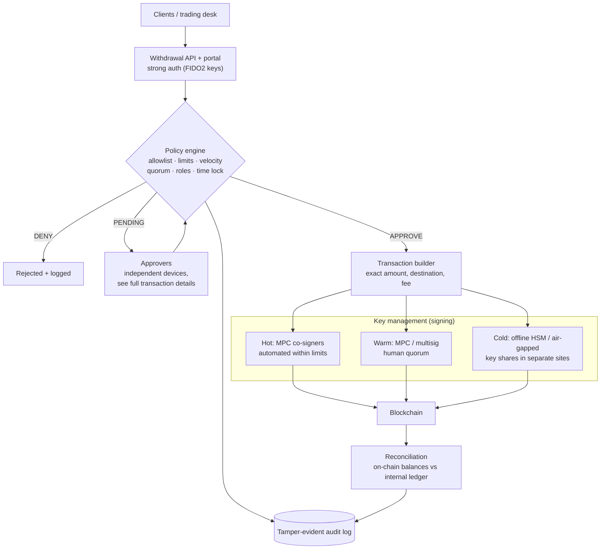
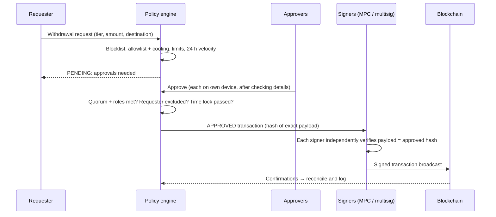

# Architecture: Institutional Digital Asset Custody

> A reference design for how an institution (a fund, an OTC desk, an exchange, a bank) can **hold and move** crypto assets safely: tiered wallets, key management (MPC, multisig, HSMs), a policy engine that checks every withdrawal before signing, and a threat model. The code in [`custody/`](custody/) is a working model of the withdrawal-policy engine. This is a study design, not a description of any real institution's setup.

## 1. The core problem

Whoever controls the private key controls the asset, and blockchain transfers can't be reversed. Custody design therefore has two goals that pull against each other:

| Goal | Pushes towards |
|---|---|
| **Security:** no single person, device or bug can move funds | Offline keys, many approvers, delays |
| **Operations:** clients and trading need timely withdrawals | Online keys, automation, speed |

The standard answer is to **split assets into tiers** by how quickly they need to move, and to put **every withdrawal through an independent policy check** before anything is signed.

## 2. Wallet tiers

| Tier | Typical share of assets | Keys | Speed | Used for |
|---|---|---|---|---|
| **Hot** | ~1–5% | Online, automated signing (e.g. MPC) under tight limits | Seconds–minutes | Routine client withdrawals |
| **Warm** | ~5–15% | Online but human-approved signing (MPC/multisig, quorum) | Minutes–hours | Larger transfers, refilling the hot wallet |
| **Cold** | The rest | Offline: air-gapped devices or offline HSMs, split across locations | Hours–days, time-locked | Long-term holdings |

The percentages are common illustrative ranges, not a standard. Each institution sets them from its withdrawal patterns and risk appetite. The tool's `allocation` command flags a tier that holds more than its limit (example: hot at 3.5% against a 2% limit → move $1.5M colder).

## 3. Architecture overview

**Transaction lifecycle**

## 4. Key management options

| | **MPC (threshold signatures)** | **Multisig** | **HSM** |
|---|---|---|---|
| How it works | The key is generated as shares held by different parties and is **never assembled in one place**. A threshold (e.g. 2-of-3) jointly produces a normal signature | The blockchain itself requires M-of-N separate keys (native on Bitcoin; smart-contract wallets on Ethereum) | Tamper-resistant hardware that generates and uses keys without exposing them, certified to standards such as FIPS 140-2/140-3 |
| On-chain footprint | Looks like a single normal signature: private, cheaper fees | Policy visible on-chain; higher fees on some chains | Depends on the scheme it's used with |
| Chain support | Broad (one approach across many chains) | Different per chain; some chains have none | Depends on supported curves and algorithms |
| Changing signers | Re-share keys off-chain, same address | Usually a new address or contract change | Hardware procedures |
| Main risks | Implementation bugs in complex cryptography; vendor dependence | Smart-contract bugs; **signers approving what a compromised interface shows them** | Physical and operational access; availability |

**Lesson from real incidents:** in February 2025, attackers took roughly $1.5 billion in ETH from the exchange Bybit's cold multisig wallet. The signers approved what they saw, but a compromised third-party wallet interface showed them a different transaction from the one they actually signed. The control that matters is that **every signer verifies the real transaction payload on an independent, trusted device** ("what you see is what you sign"), not on the same web interface. ADR-005 makes this a requirement.

## 5. Architecture Decision Records

### ADR-001: Three wallet tiers with share-of-assets limits
- **Decision:** Hot / warm / cold, each with a maximum share of total assets and per-transaction and 24-hour limits.
- **Why:** It caps the loss from an online compromise at the hot (and warm) balance. Regular rebalancing keeps the tiers within their limits.

### ADR-002: Hybrid key management: MPC for hot and warm, offline HSM or multisig for cold
- **Options:** MPC everywhere; multisig everywhere; HSM everywhere; hybrid.
- **Decision:** Hybrid.
- **Why:** MPC gives broad chain support and flexible signer changes for operational wallets. Cold storage benefits from fully offline keys, with shares or keys in separate locations and **no online signing path at all**.
- **Trade-off:** More than one technology to operate and audit.

### ADR-003: An independent policy engine before any signing
- **Decision:** Signers only sign transactions the policy engine has approved, and they verify the approved payload hash themselves.
- **Why:** Separates *"should this happen?"* (business rules) from *"make it happen"* (cryptography), so a compromised request path can't bypass the rules.

### ADR-004: Allowlisted destinations with a cooling period
- **Decision:** Withdrawals only go to pre-approved addresses. A newly added address can't be used for 48 hours (configurable).
- **Why:** A common attack is to add an attacker's address and withdraw at once. The delay gives time to detect it. Address changes themselves need approval.

### ADR-005: Maker-checker, role-based quorum, and clear signing
- **Decision:** The requester can never approve their own withdrawal. Larger tiers need specific roles (risk, executive). Approvers review full details on their **own device**.
- **Why:** No single insider can move funds, and an interface compromise is caught by an independent check (see §4).

### ADR-006: Time lock on cold withdrawals
- **Decision:** A cold-storage withdrawal can't be executed until 24 hours after the request.
- **Why:** Time to detect and cancel a fraudulent or coerced request. Cold assets are not meant to move quickly.

### ADR-007: Buy the signing technology, own the policy and integration
- **Options:** Build MPC/HSM signing in-house; buy from an established custody technology provider.
- **Decision:** Buy the cryptographic core. Own the policy rules, approval workflow, ledger integration and monitoring.
- **Why:** Threshold cryptography is very hard to implement safely. The institution's differentiator and accountability lie in its policies and controls.

## 6. Threat model (STRIDE)

| Threat | Example | Controls in this design |
|---|---|---|
| **S**poofing | Attacker poses as an approver | Phishing-resistant hardware keys (FIDO2), device binding, out-of-band confirmation for policy changes |
| **T**ampering | Transaction changed between approval and signing; malicious UI | Payload hash approved by policy and verified by each signer on an independent device |
| **R**epudiation | "I never approved that" | Tamper-evident audit log of every request, approval and policy change |
| **I**nformation disclosure | Key share exfiltrated | MPC (no full key anywhere), HSMs, shares in separate sites and organisations |
| **D**enial of service | Approvers or signers unavailable; key share lost | Quorum with spare members (2-of-3, 3-of-5), tested backup and recovery ceremonies |
| **E**levation of privilege | Insider raises limits or adds an address | Policy changes need a quorum *and* a time lock; maker-checker; alerts |

## 7. Risk register

| ID | Risk | Likelihood | Impact | Mitigation |
|---|---|---|---|---|
| R-01 | Hot wallet compromise | Medium | High | Small hot balance (ADR-001), per-transaction and velocity limits, allowlist |
| R-02 | Signers approve a manipulated transaction (blind signing) | Medium | Critical | Independent verification of the exact payload (ADR-005) |
| R-03 | Insider fraud or collusion | Low | Critical | Maker-checker, role diversity in quorums, time locks, monitoring |
| R-04 | Key loss (shares or backups destroyed) | Low | Critical | Geographic distribution, tested recovery ceremonies, spare quorum members |
| R-05 | Withdrawal to a sanctioned address | Low | High | Blocklist screening, blockchain analytics provider, allowlist |
| R-06 | Vendor failure or lock-in (MPC provider) | Low | High | Exit and recovery plan agreed contractually; key-share export or escrow arrangements |
| R-07 | Ledger and blockchain balances drift apart | Medium | Medium | Automated reconciliation with alerts |
| R-08 | Regulatory non-compliance (segregation, Travel Rule, reporting) | Medium | High | Legal review per jurisdiction; e.g. EU MiCA custody obligations; FATF Travel Rule for transfers between service providers |

## 8. Cost considerations

Exact figures depend on contracts and scale, so this lists the cost categories and their usual shape rather than invented prices:

| Item | Shape of the cost |
|---|---|
| MPC / custody technology platform | Enterprise licence, usually priced on assets or transaction volume, negotiated per contract |
| HSMs for cold storage | Hardware appliances, commonly in the tens of thousands of USD each, plus support; at least two sites |
| Secure facilities and key ceremonies | Vault or safe-deposit storage, travel, independent witnesses |
| Insurance (crime / specie) | Premium based on assets covered and the quality of controls |
| Audits and certifications (e.g. SOC 2 Type II) | Annual audit fees and the internal effort to prepare |
| People | Security, operations and compliance staff. Usually the largest ongoing cost |

## 9. About the code

`custody/policy.py` implements the policy engine from §3 so the rules can be tested, not just described: blocklist, allowlist with cooling period, per-transaction and rolling 24-hour limits, quorum with required roles, maker-checker, and cold-storage time lock, plus a tier-allocation check. 11 example requests in `examples/requests.json` cover each outcome. Each request is evaluated against the recorded history only. Approving one request in the example doesn't add it to the history used by the next one, which a production engine would do.
